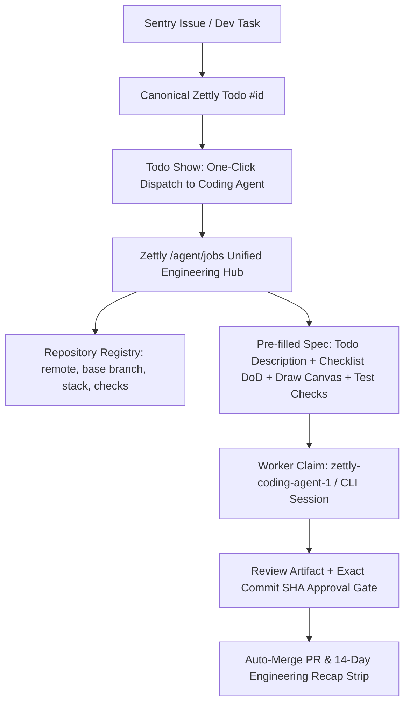

# Consolidate Factory Engineering Features into Zettly Coding Agent Workspace

**Date:** 2026-11-10
**Repository:** `D:\code\zettly` (`programinglive/zettly`)
**Canonical Zettly Todo:** `#508`
**Linked Zettly Draw:** `https://zettly.programinglive.com/draw/160`

## 1. Context & Problem Statement

Previously, software development tasks were split across **Zettly** (`zettly.programinglive.com`) and **Factory** (`factory.programinglive.com`), requiring dual-synchronization in `dev-workflow` MCP and separate triage tools (`triage.mjs`) to reconcile ghost or duplicate tasks. Meanwhile, Zettly already hosts the Coding Agent control plane (`/agent/jobs` and `/agent/setup`) backed by the GCE worker VM `zettly-coding-agent-1`, Zettly Draw Studio (`/draw/{id}`), and Todo checklists.

To simplify the architecture and eliminate tool sprawl, **Factory is retired** and its core engineering management capabilities are consolidated directly into Zettly.

## 2. Target Architecture

## 3. Consolidated Features from Factory into Zettly

1. **Enriched Project / Repository Registry (`config/coding_agent.php`, `/agent/setup`, `/agent/jobs`):**
   - Normalize repository definitions so each entry provides `slug`, `name`, `remote`, `base` (default branch), `stack` (`Laravel`, `Node.js`, `React`, etc.), and `checks` (test verification command such as `php artisan test` or `npm test`), while remaining 100% backward-compatible with string-valued repository configs in existing tests (`['zettly' => 'programinglive/zettly']`).
   - Display the registered repositories and their verification commands in `/agent/setup` and `/agent/jobs`.

2. **Todo-to-Coding-Agent Context Pre-fill & One-Click Dispatch (`Pages/Todos/Show.jsx`, `Pages/Agent/Index.jsx`, `CodingAgentJobController`, `CodingAgentPromptController`):**
   - Add a **"Send to Coding Agent"** button on `Pages/Todos/Show.jsx` (when `canUseCodingAgent` is true and the item is an actionable Todo) linking to `/agent/jobs?todo_id={todo.id}`.
   - Enrich the `todos` list passed to `Agent/Index.jsx` with `description`, `checklist_items` (Definition of Done items), and `tags` (including `proyek:*` tag to auto-select the matching repository).
   - When selecting a Todo or opening `/agent/jobs?todo_id={id}`, allow one-click **Load Todo Spec & DoD** (and auto-populate when `todo_id` query param is present and instruction is empty) combining Todo title, description, checklist items (as Definition of Done), and repository test checks.
   - Include Todo checklist items and repository test checks in `CodingAgentPromptController::generate` when generating AI prompts via Kenari.

3. **Unified Engineering Pipeline Filter & Live Worker/Session Status (`Pages/Agent/Index.jsx`, `jobView.js`):**
   - Interactive pipeline stage filter (`All`, `Queued`, `Running`, `Needs Input`, `Review / PR Ready`, `Completed`, `Failed / Cancelled`).
   - Live Worker & CLI Session status banner showing active `AgentSession` records (`HELLOWORLD`, `MMCH`, `Mac`, `zettly-coding-agent-1`) and recent worker heartbeat health.

4. **14-Day Engineering Recap Strip (`CodingAgentJobController`, `Pages/Agent/Index.jsx`):**
   - Replaces Factory's `/#rekap` view directly inside `/agent/jobs`:
     - Period counters (`Today`, `This Week`, `This Month`, `All Completed`) in `Asia/Jakarta` timezone.
     - Interactive 14-day completion bar strip.
     - Per-repository job breakdown.

5. **Factory Backlog Migration & Dev-Workflow Alignment:**
   - Ensure active backlog tasks from Factory are preserved in Zettly Todos so zero actionable backlog items are lost when Factory is retired.
