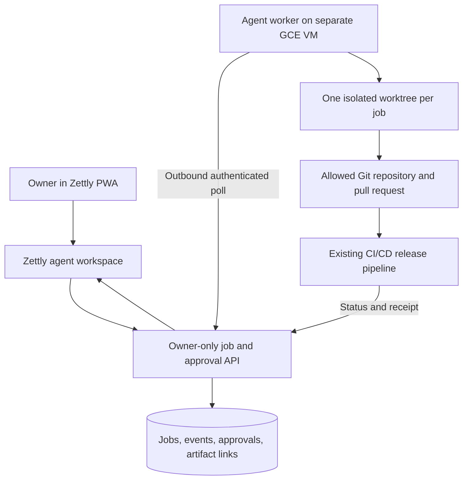

# Zettly Mobile Coding Agent Design

- **Date:** 2026-11-10
- **Status:** Written specification approved by owner on 2026-11-10; implementation planning in progress
- **Canonical Todo:** Zettly #481
- **Architecture flow:** [Zettly Draw #140](https://zettly.programinglive.com/draw/140)

## Purpose and success criteria

The owner needs to assign coding work and resolve production bugs from Zettly on a phone, including during a train commute. Only `mahatma.mahardhika@programinglive.com` may see or control this agent in the initial release. A successful task has a visible state, concise progress, test evidence, a reviewable diff or pull request, and a clear next action. A production fix reaches production only through the repository's existing CI/CD release workflow after owner approval.

The phone interface is an authenticated control and review surface. Work continues on the VM if the phone loses connectivity. Zettly shows the latest persisted state after reconnection; offline commands are not queued in the initial release.

## Existing system and gap

Zettly is Laravel 12, React, Inertia, and Tailwind. It already has Todos, a PWA, a journal, Sanctum authentication, and `/api/v1/agent/sessions` plus event ingestion. Those agent endpoints record telemetry from a client but do not dispatch coding jobs, accept follow-up instructions, expose review artifacts, or gate a release. The new feature must add those controls without using the journal or agent telemetry as a second task queue.

The existing Dev Workflow task and linked Zettly Todo remain the canonical work record. The agent job references that Todo and workflow task ID. The current per-repository branch, tests, commit, and release rules continue to govern each target project.

## Recommended architecture

Zettly owns job intent, owner decisions, and the display. A dedicated Compute Engine VM runs one agent worker. The worker polls Zettly over outbound TLS, claims one job with a lease, and posts bounded status events. Zettly never sends arbitrary shell commands from a browser request. The worker maps an approved repository identifier to a configured checkout, creates a fresh branch and worktree, invokes the coding harness with task context, runs the repository's required local checks, and publishes a diff or pull request. A job may be cancelled or resumed through explicit state transitions; a lost lease returns the job to a recoverable state without running a second worker on the same worktree.

The worker uses a dedicated machine identity and a token limited to agent job capabilities. Browser sessions use the normal Zettly login. Server-side authorization checks the authenticated user's configured owner ID and verified email on every agent page and mutation; the existing `super-admin` role alone does not grant agent access. Hiding navigation alone is insufficient. The worker token cannot approve its own work or a release. Job, event, and approval records are scoped to the owner; they are separate from organization-shared Todos.

## Mobile workflow

1. The owner opens an Agent section in the Zettly PWA, selects an allowlisted repository and an existing Todo, and submits the task. A short free-text instruction and optional error link or log excerpt provide context.
2. The page shows `queued`, `running`, `needs_input`, `review`, `release_pending`, `completed`, `failed`, or `cancelled`, with a short progress timeline and a link to detailed logs. Events are persisted before broadcasting so reconnecting does not lose state.
3. The owner can add an instruction, pause or cancel the job, and open a summary of files changed, tests, risks, and the pull request. Actions are large enough for a phone screen; long logs and diffs have links to their full view.
4. For a production bug, the owner reviews the exact repository, target environment, commit SHA, test result, and diff summary, then presses one **Approve release** action. The approval is bound to that SHA and becomes invalid if the code changes. Zettly records the approval and asks the established CI/CD workflow to run. The final pipeline result and deployment receipt return to the task page. A failed test or CI gate blocks release; the agent may prepare a revision but cannot override the gate.

The first release does not expose a browser terminal, arbitrary command execution, automatic production deployment, or public access to the agent.

## Security and infrastructure

- Start with one `e2-standard-2` VM (2 vCPU, 8 GiB RAM), a 50–100 GiB persistent disk, and a hosted model API. This is a pilot size for one active coding job, not a capacity claim for multiple concurrent agents or local model inference.
- Place the worker on a separate VM from Zettly and production application hosts. Do not give it an inbound public application port. Administrative SSH uses IAP and a restricted firewall rule. An internal-only VM still needs an explicit outbound path for Zettly, source control, package registries, and the model API; price Cloud NAT or another approved egress design before provisioning.
- Use a dedicated least-privilege VM service account. Store model and source-control credentials in a secret store and issue repository-scoped, short-lived credentials where supported. Do not copy a personal gcloud login, production SSH key, or broad Owner credential to the VM.
- Allowlist repositories and workflows. Run jobs under an unprivileged account with per-job filesystem isolation and resource/time limits. Redact secrets from prompts, logs, events, and artifacts. Production data and customer records are out of scope for the agent's default access.
- Require owner authorization for every mutating Zettly endpoint and a separate owner approval record for release. The existing no-direct-production-hotfix rule remains absolute: no source, view, configuration, or release file mutation over SSH.

## Reliability and observability

The worker sends a heartbeat. A missing heartbeat marks a running job as interrupted, preserving its branch and artifacts for inspection. Retries use idempotency keys and leases so network reconnection does not duplicate a task or approval. Zettly retains a concise event timeline and links to full CI logs. Push notifications may report `needs_input`, `review`, and failed CI states, but notification delivery does not change job state. The owner can continue reviewing the persisted task after cellular connectivity returns.

## Delivery boundaries

1. **Control plane:** Add owner-only Zettly routes, job and approval records, mobile pages, and tests for authorization, state transitions, reconnect behavior, and release gating. Reuse Todo and current agent session telemetry where appropriate.
2. **Worker pilot:** Provision the separate VM through reviewed infrastructure configuration, deploy the worker through CI/CD, connect one allowlisted repository, and prove branch/worktree isolation plus status round trips. No production credentials are installed.
3. **Production release integration:** Add repository-specific CI/CD adapters and receipt verification. Pilot one low-risk project before enabling the first production bugfix path. Each repository retains its own release gates.

The implementation plan should cover the first boundary first, then use its verified API contract for the VM pilot. New repository adapters require their own acceptance checks; a generic release button must not silently bypass target-specific rules.

## Preconditions and open checks

- The current `phrasal-ground-377312` inventory returned zero VMs and disks on 2026-11-10, while an older server handover listed two VMs. Reconcile that difference before choosing network placement or reusing existing infrastructure.
- `technology@edmeeclinic.com` has project Owner and Compute Engine is enabled, but Cloud Billing API is disabled, so billing attachment and current pricing were not verified. Confirm billing and set a budget/alert before creating a billable VM.
- Confirm the first repository and model provider during implementation planning. They determine the minimal source-control permissions, runner image, and cost ceiling. The initial owner-only and manual release-approval requirements are already decided.
